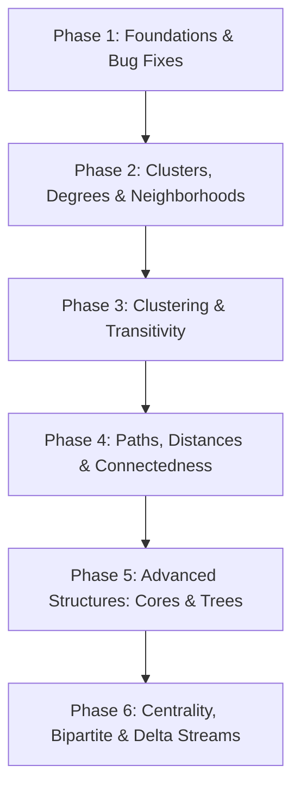

# Gap Analysis: Stream Graphs and Link Streams in DyNetx

This document identifies the measures, definitions, and analytical elements described in the Latapy et al. paper (*"Stream Graphs and Link Streams for the Modeling of Interactions over Time"*) that are not implemented (or are implemented differently) in the current `dynetx` codebase. It also proposes a phased implementation plan for full integration.

---

## 1. Metric Gap Analysis

### Section 4: Size, Duration, Uniformity, and Compactness
* **Number of links ($m$)**: 
  * *Paper*: $m = \frac{|E|}{|T|}$ (average number of active links over time).
  * *DyNetx*: Not implemented. `size(t=None)` returns the size of the flattened graph.
* **Node duration ($k$)**: 
  * *Paper*: $k = \frac{|W|}{|V|}$ (average duration of presence of a node).
  * *DyNetx*: Not implemented.
* **Link duration ($l$)**: 
  * *Paper*: $l = \frac{|E|}{|V \otimes V|}$ (average duration of presence of a link).
  * *DyNetx*: Not implemented.
* **Compactness ($c(S)$)**: 
  * *Paper*: $c(S) = \frac{|W|}{|T' \times V'|} = \text{cov}(S')$, where $T'$ is the active time interval and $V'$ is the set of nodes active at least once.
  * *DyNetx*: Not implemented.

### Section 5: Density
* **Node Density ($\delta(v)$)**: 
  * *Paper*: $\delta(v) = \frac{\sum_{u \neq v} |T_{vu}|}{\sum_{u \neq v} |T_v \cap T_u|}$.
  * *DyNetx*: Implemented as `node_density(self, u)` in `dyngraph.py`. However, **it contains a bug**: the denominator includes $u = v$, dividing by an inflated overlap sum.

### Section 6: Substreams and Clusters
* **Cluster & Substream Representations**:
  * *Paper*: A cluster $C \subseteq W$ is a set of (time, node) pairs. An induced substream $S(C) = (T, V, C, E(C))$ represents the interactions between elements of $C$.
  * *DyNetx*: Lacks formal `Cluster` or `Substream` classes or data structures.

### Section 7: Cliques
* **Stream Cliques**:
  * *Paper*: A cluster $C$ of density 1. Includes concepts of maximal, compact, and uniform cliques.
  * *DyNetx*: No clique detection algorithms or representations are implemented.

### Section 8: Neighborhood and Degree
* **Neighborhood ($N(v)$)**:
  * *Paper*: $N(v) = \{(t, u), (t, uv) \in E\}$ (a temporal cluster representing $v$'s active connections).
  * *DyNetx*: Not implemented. `neighbors()` returns neighbors in the flattened graph or a single snapshot.
* **Node Degree ($d(v)$)**:
  * *Paper*: $d(v) = \frac{|N(v)|}{|T|} = \sum_{u \neq v} m_{uv}$.
  * *DyNetx*: Not implemented. `temporal_degree()` returns node active snapshot counts, not average neighborhood size over time.
* **Average Node Degree ($d(V)$)**:
  * *Paper*: $d(V) = \frac{1}{n} \sum n_v d(v)$.
  * *DyNetx*: Not implemented.
* **Expected Degree ($\bar{d}(v)$)**:
  * *Paper*: Average instantaneous degree of $v$ when present.
  * *DyNetx*: Not implemented.
* **Expected Degree at time $t$ ($\hat{d}(t)$)**:
  * *Paper*: Average degree of nodes active at time $t$.
  * *DyNetx*: Not implemented.
* **Average Time Degree ($d(T)$)**:
  * *Paper*: Time-weighted average of degrees.
  * *DyNetx*: Not implemented.
* **Global Stream Degree ($d(S)$)**:
  * *Paper*: $d(S) = \frac{2|E|}{|T \times V|}$.
  * *DyNetx*: Not implemented.
* **Average Expected Degree ($\hat{d}(S)$)**:
  * *Paper*: $\hat{d}(S) = \frac{2|E|}{|W|}$.
  * *DyNetx*: Not implemented.

### Section 9: Clustering Coefficient and Transitivity Ratio
* **Clustering Coefficient ($cc(v)$)**:
  * *Paper*: Density of the neighborhood $N(v)$: $cc(v) = \frac{\sum_{uw} |T_{vu} \cap T_{vw} \cap T_{uw}|}{\sum_{uw} |T_{vu} \cap T_{vw}|}$.
  * *DyNetx*: The function `temporal_clustering` in `algorithms/temporal.py` computes the time-average of standard NetworkX clustering coefficients: $\frac{1}{|T|}\sum cc_t(v)$. This is conceptually distinct from the neighborhood-density definition of the paper.
* **Node Clustering Coefficient ($cc(V)$)**:
  * *Paper*: $cc(V) = \sum \frac{|T_v|}{|W|} cc(v)$.
  * *DyNetx*: Not implemented.
* **Transitivity Ratio ($\text{tr}(S)$)**:
  * *Paper*: Ratio of triangles to connected triplets across the stream: $\text{tr}(S) = \frac{|\Delta|}{|\lor|}$.
  * *DyNetx*: `temporal_transitivity` averages snapshot transitivities over time, which is different from the paper's global ratio.
* **Time Clustering Coefficient ($cc(T)$)** and **Stream Clustering Coefficient ($cc(S)$)**:
  * *Paper*: Area-normalized variants of the clustering coefficient.
  * *DyNetx*: Not implemented.

### Section 10 & 11: Cluster Metrics and Quotient Streams
* **Internal/External Neighborhoods & Degrees of Clusters**:
  * *Paper*: $N_C(v)$, $\overline{N_C}(v)$, $d_C(v)$, $\overline{d_C}(v)$, $d_C(C)$, $d(C)$, $\overline{d}(C)$.
  * *DyNetx*: Not implemented.
* **Quotient Stream ($Q$)**:
  * *Paper*: A stream graph induced by grouping nodes into cluster families $F$.
  * *DyNetx*: Not implemented.
* **Intra-cluster, Inter-cluster, and External Densities**:
  * *Paper*: $\delta(F)$, $\overline{\delta}(F)$, $\overline{\delta}(C)$.
  * *DyNetx*: Not implemented.

### Section 12: Line Streams
* **Line Stream ($\hat{S}$)**:
  * *Paper*: Link-based dual graph of a stream graph.
  * *DyNetx*: Not implemented.

### Section 13: $k$-Cores
* **Stream $k$-Core, Core Number, and $k$-Shell**:
  * *Paper*: Largest sub-cluster of nodes where all elements maintain instantaneous degree $d_t(v) \ge k$ inside the cluster.
  * *DyNetx*: Not implemented.

### Section 14: Paths and Distances
* **Foremost Path Time-to-Reach ($\mathcal{T}_{\alpha}$)**:
  * *Paper*: Minimum time difference $\omega - \alpha$ to reach a target.
  * *DyNetx*: Not implemented.
* **Lapse, Diameter, and Flood Time**:
  * *Paper*: Maximum latency, maximum topological distance, and maximum arrival time over all pairs.
  * *DyNetx*: Not implemented.
* **$\gamma$-paths and Forwarding Delays**:
  * *Paper*: Paths accounting for transmission delay $\gamma$ and forwarding delay $\gamma'$.
  * *DyNetx*: Not implemented.

### Section 15: Connectedness and Connected Components
* **Weak Connectedness**:
  * *Paper*: Reachability $(\alpha, u) \sim (\omega, v)$ without time-respecting ordering constraints.
  * *DyNetx*: Not implemented. `temporal_connected_components` returns components per snapshot, not across time.
* **Strong Connectedness**:
  * *Paper*: Evolving paths exist for all pairs with $\alpha \le \omega$.
  * *DyNetx*: Not implemented.
* **Strongly Connected Components**:
  * *Paper*: Partition of W into maximal compact strongly connected clusters.
  * *DyNetx*: Not implemented.
* **Reachability Stream Graph ($R$)**:
  * *Paper*: Graph showing reachability links at each time step.
  * *DyNetx*: Not implemented.

### Section 16: Trees and Cascades
* **Predecessor Mapping ($p(t, v)$)**:
  * *Paper*: Unique parent in a temporal tree.
  * *DyNetx*: Not implemented.
* **Shortest/Fastest/Foremost-Path Trees and Cascades**:
  * *Paper*: Tree structures optimized for specific path dimensions.
  * *DyNetx*: Not implemented.

### Section 17: Closeness and Betweenness Centralities
* **Temporal Closeness Centrality ($\mathcal{C}_t(v)$)**:
  * *Paper*: $\mathcal{C}_t(v) = \sum_{u} \int_{T} \frac{1}{c_t(v, (s, u))} ds$.
  * *DyNetx*: Lacks the continuous/discrete integral formulation. Only a simple heuristic `temporal_earliest_arrival_closeness` is provided.
* **Temporal Betweenness Centrality ($\mathcal{B}(t, v)$)**:
  * *Paper*: $\mathcal{B}(t, v) = \sum_{u, w} \int \frac{\sigma((i, u), (j, w), (t, v))}{\sigma((i, u), (j, w))} di dj$.
  * *DyNetx*: Lacks temporal resolution. `temporal_betweenness_centrality` returns a flat dictionary of node scores rather than time-indexed centrality values.
* **Betweenness of Clusters, Nodes, and Times**:
  * *Paper*: $\mathcal{B}(X)$, $\mathcal{B}(v)$, $\mathcal{B}(t)$.
  * *DyNetx*: Not implemented.

### Section 19: $\Delta$-Analysis
* **$\Delta$-density, $\Delta$-degree, $\Delta$-stream graph ($S_{\Delta}$)**:
  * *Paper*: Windowed structural properties.
  * *DyNetx*: Not implemented.

### Section 20: Bipartite Streams
* **Bipartite Stream Graph, Bipartite Density, Projections, Redundancy**:
  * *Paper*: Extensions for two-mode interaction streams.
  * *DyNetx*: Not implemented.

---

## 2. Proposed Phased Plan

A 6-phase plan is proposed below to complete the core representation of the Latapy stream graph framework without breaking the existing snapshot-based NetworkX compatibility features.

### Phase 1: Foundations and Bug Fixes
* **Objectives**: Fix existing correctness issues and introduce basic stream metrics.
* **Tasks**:
  1. Fix the denominator bug in `DynGraph.node_density` to exclude the node itself.
  2. Implement `DynGraph.link_count` ($m = |E|/|T|$).
  3. Implement `DynGraph.node_duration` ($k$) and `DynGraph.link_duration` ($l$).
  4. Implement `DynGraph.compactness` ($c(S)$).
  5. Add regression tests validating these core metrics on small sample streams.

### Phase 2: Clusters, Degrees, and Neighborhoods
* **Objectives**: Formalize structural components (clusters, neighborhoods) and implement the paper's degree measures.
* **Tasks**:
  1. Define a lightweight `Cluster` representation in `dynetx/classes/cluster.py` to hold a subset of temporal nodes $C \subseteq W$.
  2. Implement `DynGraph.induced_substream(cluster)`.
  3. Implement `DynGraph.temporal_neighborhood(node)`.
  4. Implement paper-compliant degree formulas:
     * Node degree $d(v)$ and average node degree $d(V)$.
     * Expected node degree $\bar{d}(v)$.
     * Degree at time step $t$ ($d(t)$) and expected degree at time $t$ ($\hat{d}(t)$).
     * Global stream degree $d(S)$ and average expected degree $\hat{d}(S)$.

### Phase 3: Stream Graph Clustering and Transitivity
* **Objectives**: Implement neighborhood-density based clustering and global transitivity.
* **Tasks**:
  1. Implement `DynGraph.stream_clustering_coefficient(node)` ($cc(v)$) based on temporal neighborhood density.
  2. Implement `DynGraph.average_stream_clustering_coefficient` ($cc(V)$).
  3. Implement `DynGraph.transitivity_ratio` ($\text{tr}(S)$) by tracking global triangles and connected triplets.
  4. Implement time clustering ($cc(T)$) and overall stream clustering ($cc(S)$).

### Phase 4: Paths, Distances, and Connectedness
* **Objectives**: Extend paths to include cost models and implement reachability/connectedness.
* **Tasks**:
  1. Implement path diagnostics: diameter, lapse, and flood time.
  2. Implement time-to-reach ($\mathcal{T}_{\alpha}$).
  3. Extend path algorithms to support $\gamma$-paths and forwarding delay constraints $\gamma'$.
  4. Implement weak reachability, weak connectedness, and weakly connected components.
  5. Implement strong connectedness and strongly connected components (returning a partition of $W$).
  6. Implement the reachability stream graph generator.

### Phase 5: Advanced Structures (Cores, Trees, Projections)
* **Objectives**: Add higher-level structures described in sections 10-13 and 16.
* **Tasks**:
  1. Implement cluster neighborhoods/degrees (internal/external).
  2. Implement quotient stream generator $Q$ and corresponding densities ($\delta(F), \overline{\delta}(F), \overline{\delta}(C)$).
  3. Implement line stream generator $\hat{S}$.
  4. Implement the stream $k$-core decomposition, returning core numbers and $k$-shells.
  5. Implement foremost/shortest/fastest-path trees and cascade generators.

### Phase 6: Centrality, Bipartite, and Delta Streams
* **Objectives**: Complete the analytical suite with centralities and specialized graph types.
* **Tasks**:
  1. Implement temporal closeness centrality $\mathcal{C}_t(v)$ using path latencies.
  2. Implement temporal betweenness centrality $\mathcal{B}(t, v)$, $\mathcal{B}(v)$, and $\mathcal{B}(t)$ based on shortest fastest paths.
  3. Implement $\Delta$-analysis utilities (generating $S_{\Delta}$, computing $\Delta$-density and $\Delta$-degrees).
  4. Create a `BipartiteDynGraph` class representing bipartite stream graphs, and implement bipartite density, bipartite projections, and bipartite redundancy $rc(v)$.
